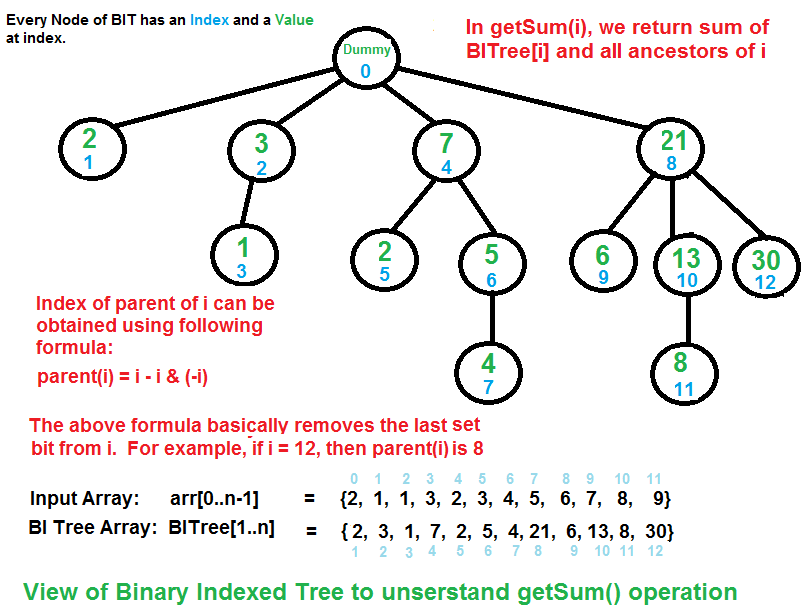
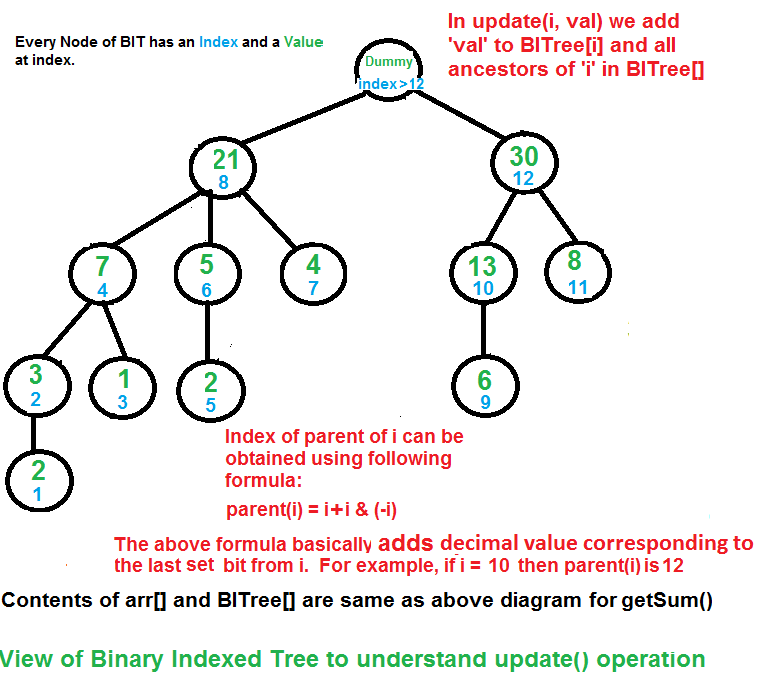

# Binary Indexed Tree or Fenwick Tree

## Introduction

Let us consider the following problem to understand Binary Indexed Tree.

We have an array `arr[0 ... n-1]`. We would like to:

1. Compute the sum of the first `i` elements.
2. Modify the value of a specified element of the array: `arr[i] = x`, where `0 <= i <= n-1`.

A **simple solution** is to run a loop from `0` to `i-1` and calculate the sum of the elements. To update a value, simply do `arr[i] = x`. The first operation takes `O(n)` time and the second operation takes `O(1)` time.

Another simple solution is to create an extra array and store the sum of the first `i` elements at the `i`-th index in this new array. The sum of a given range can now be calculated in `O(1)` time, but the update operation takes `O(n)` time. This works well if there are a large number of query operations but very few update operations.

### Could we perform both query and update operations in `O(log n)` time?

One efficient solution is to use a [Segment Tree](https://www.geeksforgeeks.org/segment-tree-set-1-sum-of-given-range/) that performs both operations in `O(log n)` time.

An alternative solution is **Binary Indexed Tree**, which also achieves `O(log n)` time complexity for both operations. Compared with Segment Tree, Binary Indexed Tree requires less space and is easier to implement.

## Representation

Binary Indexed Tree is represented as an array. Let the array be `BITree[]`. Each node of the Binary Indexed Tree stores the sum of some elements of the input array.

The size of the Binary Indexed Tree is equal to the size of the input array, denoted as `n`. In the code below, we use a size of `n+1` for ease of implementation.

## Construction

We initialize all the values in `BITree[]` as `0`. Then we call `update()` for all the indexes. The `update()` operation is discussed below.

## Operations

### `getSum(x)`: Return the sum of the sub-array `arr[0 ... x]`

```text
// Returns the sum of the sub-array arr[0 ... x] using BITree[0..n],
// which is constructed from arr[0..n-1].

1. Initialize the output sum as 0 and the current index as x + 1.
2. Do the following while the current index is greater than 0:
   a. Add BITree[index] to sum.
   b. Go to the parent of BITree[index]. The parent can be obtained by
      removing the last set bit from the current index:
      index = index - (index & (-index)).
3. Return sum.
```



The diagram above provides an example of how `getSum()` is working. Here are some important observations:

- `BITree[0]` is a dummy node.
- `BITree[y]` is the parent of `BITree[x]` if and only if `y` can be obtained by removing the last set bit from the binary representation of `x`, that is:
  `y = x - (x & (-x))`.
- The child node `BITree[x]` of the node `BITree[y]` stores the sum of the elements between `y` (inclusive) and `x` (exclusive): `arr[y ... x)`.

### `update(x, val)`: Update the Binary Indexed Tree (BIT) by performing `arr[index] += val`

> Note: The `update(x, val)` operation does not change `arr[]`. It only makes changes to `BITree[]`.

```text
1. Initialize the current index as x + 1.
2. Do the following while the current index is smaller than or equal to n:
   a. Add val to BITree[index].
   b. Go to the next element of BITree[index]. The next element can be
      obtained by incrementing the last set bit of the current index:
      index = index + (index & (-index)).
```



The update function needs to make sure that all the `BITree` nodes which contain `arr[i]` within their ranges are updated. We loop over such nodes in the `BITree` by repeatedly adding the decimal number corresponding to the last set bit of the current index.

## How does Binary Indexed Tree work?

The idea is based on the fact that all positive integers can be represented as the sum of powers of `2`. For example, `19` can be represented as `16 + 2 + 1`.

Every node of the `BITree` stores the sum of `n` elements where `n` is a power of `2`. For example, in the first diagram above (the diagram for `getSum()`), the sum of the first `12` elements can be obtained by the sum of the last `4` elements (from `9` to `12`) plus the sum of `8` elements (from `1` to `8`).

The number of set bits in the binary representation of a number `n` is `O(log n)`. Therefore, we traverse at most `O(log n)` nodes in both `getSum()` and `update()` operations. The time complexity of construction is `O(n log n)` as it calls `update()` for all `n` elements.

## Implementation

Following is the implementation of Binary Indexed Tree.

```python
# Python implementation of Binary Indexed Tree

# Returns the sum of arr[0..index].
# This function assumes that the array is preprocessed and partial sums
# of array elements are stored in BITree[].
def getsum(BITTree, i):
    s = 0  # Initialize result

    # Index in BITree[] is 1 more than the index in arr[].
    i = i + 1

    # Traverse ancestors of BITree[index].
    while i > 0:
        # Add the current element of BITree to sum.
        s += BITTree[i]

        # Move index to the parent node in the getSum view.
        i -= i & (-i)

    return s


# Updates a node in the Binary Indexed Tree (BITree) at the given index.
# The given value 'val' is added to BITree[i] and all its ancestors.
def updatebit(BITTree, n, i, v):
    # Index in BITree[] is 1 more than the index in arr[].
    i += 1

    # Traverse all ancestors and add 'val'.
    while i <= n:
        # Add 'val' to the current node of BITree.
        BITTree[i] += v

        # Update index to that of the next node in the update view.
        i += i & (-i)


# Constructs and returns a Binary Indexed Tree for the given array.
def construct(arr, n):
    # Create and initialize BITree[] as 0.
    BITTree = [0] * (n + 1)

    # Store the actual values in BITree[] using update().
    for i in range(n):
        updatebit(BITTree, n, i, arr[i])

    # Uncomment below lines to see the contents of BITree[].
    # for i in range(1, n + 1):
    #     print(BITree[i])

    return BITTree


# Driver code to test the methods above.
freq = [2, 1, 1, 3, 2, 3, 4, 5, 6, 7, 8, 9]
BITTree = construct(freq, len(freq))

print("Sum of elements in arr[0..5] is " + str(getsum(BITTree, 5)))

freq[3] += 6
updatebit(BITTree, len(freq), 3, 6)

print(
    "Sum of elements in arr[0..5]"
    + " after update is "
    + str(getsum(BITTree, 5))
)
```

## Output

```text
Sum of elements in arr[0..5] is 12
Sum of elements in arr[0..5] after update is 18
```
