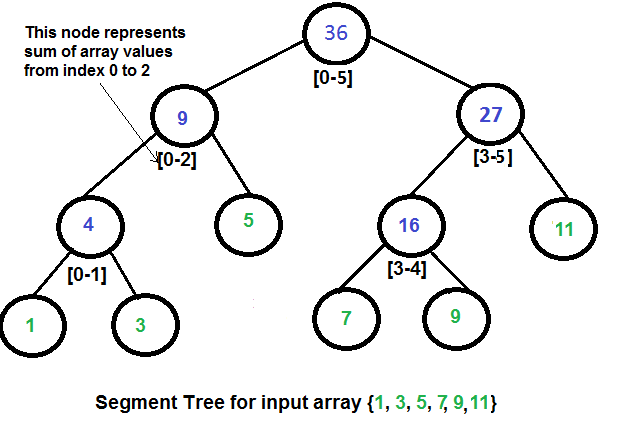

# Introduction to Segment Trees


Segment Trees are Binary Tree which is used to store intervals or segments. That is each node in a segment tree basically stores the segment of an array. Segment Trees are generally used in problems where we need to solve queries on a range of elements in arrays.

Let us consider the following problem to understand Segment Trees.

## Problem

We have an array arr[0 . . . n-1]. We should be able to perform the below operations on the array:

Find the sum of elements from index l to r where 0 <= l <= r <= n-1.
Change value of a specified element of the array to a new value x. We need to do arr[i] = x where 0 <= i <= n-1.


## General Solution

 A simple solution is to run a loop from index l to r and calculate the sum of elements in the given range. To update a value, simply do arr[i] = x. The first operation takes O(N) time for every query, where N is the number of elements in the range [l,r] and the second operation takes O(1) time.

 

### Can we optimize the time complexity of the first operation in the above solution?


Yes, we can optimize the first operation to be solved in O(1) time complexity by storing presum. We can keep an auxiliary array say sum[] in which the i-th element will store the sum of first i elements of the original array. So, whenever we need to find the sum of a range of elements, we can simply calculate it by (sum[r]-sum[l-1]). But in this solution the complexity to perform the second operation of updating an element increases from O(1) to O(N).

 

### Can we perform both operations in O(log n) time?

What if the number of query and updates are equal? Can we perform both the operations in O(log n) time once given the array?


We can use a segment tree to perform both of the operations in O(log N) time complexity.

## Representation of Segment Trees

Leaf Nodes are the elements of the input array.
Each internal node represents some merging of the leaf nodes. The merging may be different for different problems. For this problem, merging is the sum of leaves under a node.

An array representation of the tree is used to represent Segment Trees. For each node at index i, the left child is at index 2*i + 1, right child at 2*i + 2 and the parent is at (i - 1)/2.
   


### Array Representation of Segment Trees Like Heap, segment tree is also represented as an array. The difference here is, it is not a complete binary tree. It is rather a full binary tree (every node has 0 or 2 children) and all levels are filled except possibly the last level. Unlike Heap, the last level may have gaps between nodes. Below are the values in the segment tree array for the above diagram.

 

Array representation of segment tree for input array {1, 3, 5, 7, 9, 11} is,

st[] = {36, 9, 27, 4, 5, 16, 11, 1, 3, DUMMY, DUMMY, 7, 9, DUMMY, DUMMY}
 


The dummy values are never accessed and have no use. This is some wastage of space due to simple array representation. We may optimize this wastage using some clever implementations, but the code for sum and update becomes more complex.

## Construction of Segment Tree from the Given Array

 We start with a segment arr[0 . . . n-1] and every time we divide the current segment into two halves(if it has not yet become a segment of length 1), and then call the same procedure on both halves, and for each such segment, we store the sum in the corresponding node.

All levels of the constructed segment tree will be completely filled except the last level. Also, the tree will be a Full Binary Tree because we always divide segments into two halves at every level. Since the constructed tree is always a full binary tree with n leaves, there will be n-1 internal nodes. So the total number of nodes will be 2*n – 1. Note that this does not include dummy nodes.

### What is the total size of the array representing segment tree?
If n is a power of 2, then there are no dummy nodes. So the size of the segment tree is 2n-1 (n leaf nodes and n-1) internal nodes. If n is not a power of 2, the size of the tree will be 2*x – 1 where x is the smallest of 2 greater than n. For example, when n = 10, then size of array representing segment tree is 2*16-1 = 31.

 

## Query for Sum of Given Range


Following is the algorithm to get the sum of elements.
 

```text
int getSum(node, l, r) 
{
   if the range of the node is within l and r
        return value in the node
   else if the range of the node is completely outside l and r
        return 0
   else
        return getSum(node's left child, l, r) + 
               getSum(node's right child, l, r)
}
```
## Updating a Value


Like tree construction and query operations, the update can also be done recursively. We are given an index which needs to be updated. Let diff be the value to be added. We start from the root of the segment tree and add diff to all nodes which have given index in their range. If a node doesn’t have given index in its range, we don’t make any changes to that node.

## Implementation
 


```python
# Python3 program to show segment tree operations like
# construction, query and update
from math import ceil, log2;

# A utility function to get the
# middle index from corner indexes.
def getMid(s, e) :
	return s + (e -s) // 2;

""" A recursive function to get the sum of values
	in the given range of the array. The following
	are parameters for this function.

	st --> Pointer to segment tree
	si --> Index of current node in the segment tree.
		Initially 0 is passed as root is always at index 0
	ss & se --> Starting and ending indexes of the segment
				represented by current node, i.e., st[si]
	qs & qe --> Starting and ending indexes of query range """
def getSumUtil(st, ss, se, qs, qe, si) :

	# If segment of this node is a part of given range,
	# then return the sum of the segment
	if (qs <= ss and qe >= se) :
		return st[si];

	# If segment of this node is
	# outside the given range
	if (se < qs or ss > qe) :
		return 0;

	# If a part of this segment overlaps
	# with the given range
	mid = getMid(ss, se);
	
	return getSumUtil(st, ss, mid, qs, qe, 2 * si + 1) +
		getSumUtil(st, mid + 1, se, qs, qe, 2 * si + 2);

""" A recursive function to update the nodes
which have the given index in their range.
The following are parameters st, si, ss and se
are same as getSumUtil()
i --> index of the element to be updated.
	This index is in the input array.
diff --> Value to be added to all nodes
which have i in range """
def updateValueUtil(st, ss, se, i, diff, si) :

	# Base Case: If the input index lies
	# outside the range of this segment
	if (i < ss or i > se) :
		return;

	# If the input index is in range of this node,
	# then update the value of the node and its children
	st[si] = st[si] + diff;
	
	if (se != ss) :
	
		mid = getMid(ss, se);
		updateValueUtil(st, ss, mid, i,
						diff, 2 * si + 1);
		updateValueUtil(st, mid + 1, se, i,
						diff, 2 * si + 2);

# The function to update a value in input array
# and segment tree. It uses updateValueUtil()
# to update the value in segment tree
def updateValue(arr, st, n, i, new_val) :

	# Check for erroneous input index
	if (i < 0 or i > n - 1) :
		
		print("Invalid Input", end = "");
		return;

	# Get the difference between
	# new value and old value
	diff = new_val - arr[i];

	# Update the value in array
	arr[i] = new_val;

	# Update the values of nodes in segment tree
	updateValueUtil(st, 0, n - 1, i, diff, 0);

# Return sum of elements in range from
# index qs (query start) to qe (query end).
# It mainly uses getSumUtil()
def getSum(st, n, qs, qe) :

	# Check for erroneous input values
	if (qs < 0 or qe > n - 1 or qs > qe) :

		print("Invalid Input", end = "");
		return -1;
	
	return getSumUtil(st, 0, n - 1, qs, qe, 0);

# A recursive function that constructs
# Segment Tree for array[ss..se].
# si is index of current node in segment tree st
def constructSTUtil(arr, ss, se, st, si) :

	# If there is one element in array,
	# store it in current node of
	# segment tree and return
	if (ss == se) :
	
		st[si] = arr[ss];
		return arr[ss];
	
	# If there are more than one elements,
	# then recur for left and right subtrees
	# and store the sum of values in this node
	mid = getMid(ss, se);
	
	st[si] = constructSTUtil(arr, ss, mid, st, si * 2 + 1) +
			constructSTUtil(arr, mid + 1, se, st, si * 2 + 2);
	
	return st[si];

""" Function to construct segment tree
from given array. This function allocates memory
for segment tree and calls constructSTUtil() to
fill the allocated memory """
def constructST(arr, n) :

	# Allocate memory for the segment tree

	# Height of segment tree
	x = (int)(ceil(log2(n)));

	# Maximum size of segment tree
	max_size = 2 * (int)(2**x) - 1;
	
	# Allocate memory
	st = [0] * max_size;

	# Fill the allocated memory st
	constructSTUtil(arr, 0, n - 1, st, 0);

	# Return the constructed segment tree
	return st;

# Driver Code
if __name__ == "__main__" :

	arr = [1, 3, 5, 7, 9, 11];
	n = len(arr);

	# Build segment tree from given array
	st = constructST(arr, n);

	# Print sum of values in array from index 1 to 3
	print("Sum of values in given range = ",
					getSum(st, n, 1, 3));

	# Update: set arr[1] = 10 and update
	# corresponding segment tree nodes
	updateValue(arr, st, n, 1, 10);

	# Find sum after the value is updated
	print("Updated sum of values in given range = ",
					getSum(st, n, 1, 3), end = "");
```


## Output

```text
Sum of values in given range = 15
Updated sum of values in given range = 22
```

 


## Time Complexity

 The time Complexity for tree construction is O(n). There are total 2n-1 nodes, and the value of every node is calculated only once in tree construction.

**Query:** Time complexity to query is O(Logn). To query a sum, we process at most four nodes at every level and number of levels is O(Logn).

**Update:** The time complexity of the update is also O(Logn). To update a leaf value, we process one node at every level and number of levels is O(Logn).
